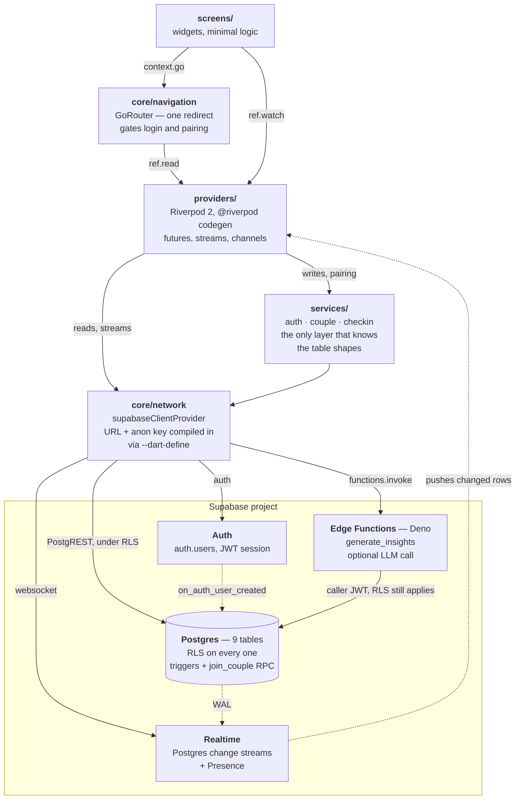
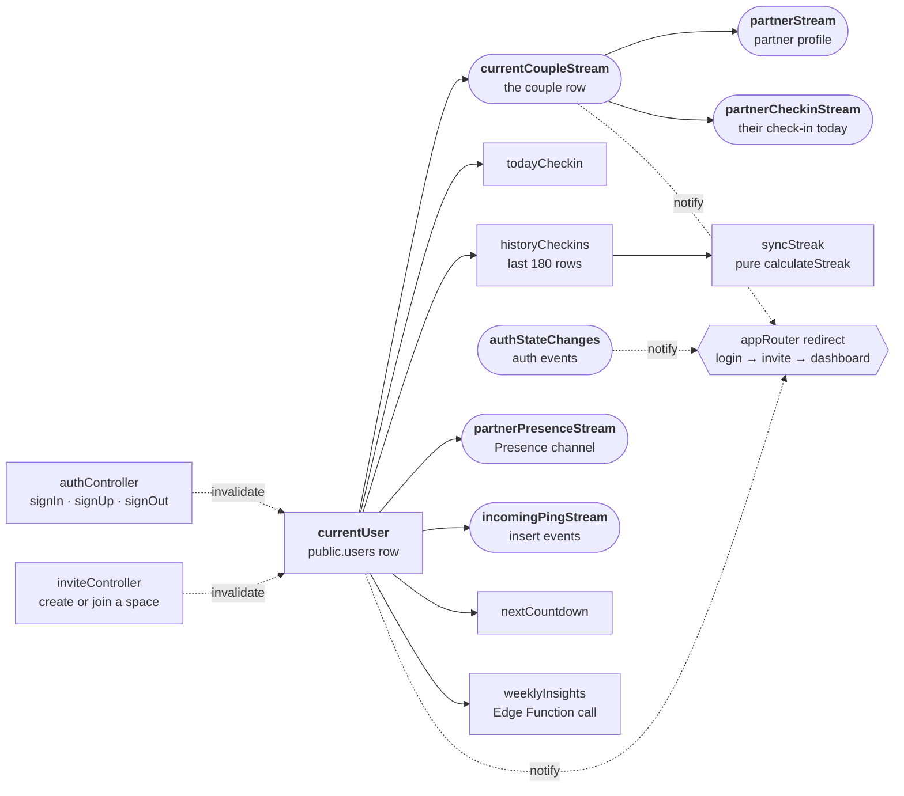
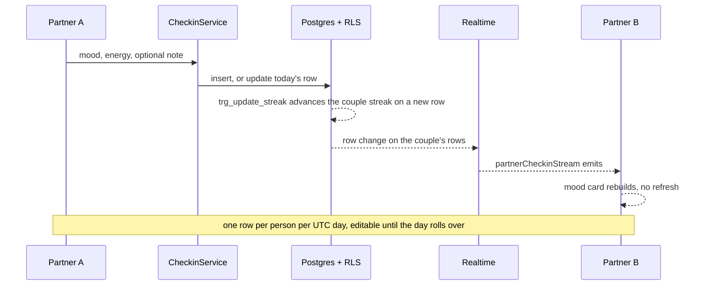

# LDR: Emotional Sync

I built this for couples living in different time zones. Once a day each
partner records how their day actually went, and the other person sees it the
moment it lands. My bet is that a small, steady, low-effort signal keeps two
people closer than the occasional long call.

It's a Flutter app on a Supabase backend (Postgres, Auth, Realtime and Edge
Functions).

**Live demo:** https://ldr-app-v1-n9fe.vercel.app

It's a web build of a phone app, so open it in a narrow window or turn on your
browser's device toolbar. [Reviewing the app](#reviewing-the-app) explains how
to get past the login screen and how to see the two-partner behaviour, which is
the whole point of the app and needs two accounts.

---

## What it does

| Surface | Behaviour |
| --- | --- |
| **Pairing** | One partner creates a shared space and gets an 8-character invite code, and the other redeems it. The creator waits on the invite screen with their code until the partner joins. If both of you created a space, either one can still enter the other's code. |
| **Daily check-in** | Mood, energy (1 to 10) and an optional note. One check-in per person per UTC day, editable until the day rolls over. |
| **Dashboard** | Your partner's mood today, whether they're online, the shared streak, the next milestone, and a "thinking of you" nudge with a 60-second cooldown. |
| **Journey** | The couple's shared timeline, day by day, with a per-day sync score based on how closely your energy levels matched. |
| **Insights** | A weekly summary from an Edge Function, optionally written by an LLM. |

---

## Architecture

I organised the code feature-first and kept the layering thin. Each feature
owns its screens and its providers, and anything shared lives in `core/` or
`shared/`.



Every arrow into Postgres carries the signed-in user's JWT, including the
ones from the Edge Function. The RLS policies decide what comes back, not the
client. The anon key is compiled in and is public by design.

```
main.dart              Supabase init from --dart-define, ProviderScope
core/
  navigation/          GoRouter + the redirect that gates on auth/pairing state
  network/             Supabase client provider
  theme/               Colours, typography (fonts bundled, see below)
models/                Freezed + json_serializable domain models
services/              Supabase reads/writes; the only layer that knows SQL-ish detail
shared/                Mood catalog, reusable widgets
features/<name>/
  providers/           Riverpod (codegen); async + realtime state
  screens/             Widgets, minimal logic
supabase/
  migrations/          One consolidated schema migration
  functions/           Edge Functions (Deno)
  tests/               SQL smoke test exercising RLS end to end
```

**State.** I used Riverpod 2 with `@riverpod` codegen throughout. Providers
compose instead of fanning out from one store: `currentUser` → `currentCouple`
→ `partner` → `partnerCheckin`, and each one invalidates the ones downstream
of it automatically.



Rounded nodes are live subscriptions (a Postgres change stream or a Presence
channel). Square ones are futures that refetch when something upstream is
invalidated. Dotted edges carry invalidation and router notifications, not
data. `currentUser` is the hinge: a sign-in, a sign-out or a pairing
invalidates it, and everything to the right of it refreshes. A check-in also
invalidates `historyCheckins`, so the streak and the Journey timeline update
straight away.

**Routing.** A single `GoRouter` whose `redirect` is the app's real state
machine: signed out goes to `/login`, signed in but not yet paired goes to
`/invite`, and paired goes to `/dashboard`. Screens never make routing
decisions themselves. The router is built once and refreshed through a
`Listenable`, and the redirect `read`s instead of `watch`ing so it doesn't
rebuild the router mid-navigation. If the first profile fetch fails (offline at
launch, say), the redirect parks on the splash screen, which shows a Retry
button instead of spinning forever.

**Realtime.** The couple row, the partner's profile and check-ins come through
Supabase's Postgres change streams. The online dot uses one Presence channel
per couple, and `last_seen` is the coarse fallback when the socket isn't live.
Two things I had to learn here:

- Tables behind a `.stream()` have to be in the `supabase_realtime`
  publication and set to `REPLICA IDENTITY FULL`. A table missing from the
  publication gives you a stream that silently never emits. The migration
  does both.
- Only open one Presence channel per topic. I originally had one provider
  that tracked the user and a second that listened, both on the same topic.
  When the second subscribes, the realtime client leaves the first, so the
  `track()` call never happened and nobody ever showed as online. Now a single
  channel does both.

One check-in, end to end. This is the round trip the whole product is built
on:



---

## Data model

Nine tables. `couples` is the tenancy boundary: almost every policy turns
"can this user see this row?" into "are they `partner_1_id` or `partner_2_id`
of the couple that owns it?".

```
auth.users ──1:1──> users ──┐
                            ├──> daily_checkins ──> (trigger) streaks
                  couples ──┤
                            ├──> relationship_pings
                            ├──> daily_prompt_answers
                            ├──> countdown_events
                            └──> ai_insights
users ──1:1──> subscriptions
```

I enforce three invariants in the database instead of in Dart, because the
client isn't a trustworthy place to enforce anything:

- **One check-in per person per UTC day.** A unique index on
  `(user_id, date(timezone('utc', created_at)))`.
- **Scores are 1 to 10.** `CHECK` constraints. The client clamps to the same
  bounds, so a UI change can't quietly start producing writes that get
  rejected.
- **Pairing is atomic.** `join_couple()` is `SECURITY DEFINER` and takes a row
  lock, because under RLS the joiner can't see or update the couple row until
  the moment they become a member of it. If the joiner had already created a
  space of their own that is still waiting for a partner, the join removes it,
  so two people who both tapped "create a space" can still pair. It refuses
  anyone who is already in a complete couple.

RLS membership checks go through a `SECURITY DEFINER` helper
(`is_couple_member`) that reads `couples`. My first version resolved pairing
inside a `users` policy by selecting from `users`. That recurses, and Postgres
aborts the query with `infinite recursion detected in policy`. The policy
looked obviously correct, which is what made it a good lesson.

---

## Reviewing the app

There are three ways in, cheapest first. All of them hit the same wall
eventually: this is a two-person app, so one reviewer needs **two accounts** to
see anything interesting. That part is covered at the end of this section.

### 1. The hosted build (no setup)

https://ldr-app-v1-n9fe.vercel.app

Sign up with any email and password. The layout is phone-shaped, so narrow the
window or switch on your browser's device toolbar.

If sign-up seems to work but login then fails, the Supabase project still has
**Confirm email** turned on and the account is waiting on a confirmation link.

If nothing loads past the login screen at all, the backend is probably asleep.
The hosted project runs on Supabase's free tier, which pauses a project after a
week without traffic. I restore it from the Supabase dashboard (or run it
locally with option 2 or 3 in the meantime).

### 2. Locally, against the same backend (about 5 minutes)

This is the fastest way to run the code itself. You only need Flutter 3.44 or
newer. You can reuse the deployed project's credentials, since the anon key is
already public in the deployed bundle.

```bash
git clone https://github.com/aquiadi/LDR_App_V1.git && cd LDR_App_V1
flutter pub get
dart run build_runner build --delete-conflicting-outputs

flutter run -d chrome \
  --dart-define=SUPABASE_URL=https://<project>.supabase.co \
  --dart-define=SUPABASE_ANON_KEY=<anon-key>
```

The only targets are `chrome` and `macos`. There are no Android or iOS folders
yet (see [Known gaps](#known-gaps)).

If you launch without the two `--dart-define`s, the app boots to a screen that
names exactly what's missing instead of crashing. That's expected.

**Everyone shares one database this way.** Sign-ups and check-ins are visible to
whoever else is testing. For an isolated run, use option 3.

### 3. Locally, against a local Supabase (fully isolated)

You need Docker and the Supabase CLI. Nothing leaves your machine.

```bash
supabase start          # boots Postgres, Auth, Realtime; prints URL + keys
supabase db reset       # applies supabase/migrations
```

`supabase start` prints an API URL (usually `http://127.0.0.1:54321`) and a
publishable (anon) key. Pass those in:

```bash
flutter run -d chrome \
  --dart-define=SUPABASE_URL=http://127.0.0.1:54321 \
  --dart-define=SUPABASE_ANON_KEY=<key from supabase start>
```

A local stack doesn't send real email, so accounts work straight away. Anything
the app would have mailed lands in the local mail catcher at
http://127.0.0.1:54324. Run `supabase stop` when you're done.

### Seeing the two-partner behaviour

With one account the dashboard is mostly empty. The partner's mood, the online
dot, the sync score and the streak all need a second person. To pair with
yourself:

1. Sign up as user A, choose **I want to create a space** and finish
   onboarding. Copy the 8-character invite code.
2. Open a **second browser profile or an incognito window**. A new tab isn't
   enough, because the session is shared per profile. Sign up as user B.
3. As user B, enter A's invite code. (If B also created a space by mistake,
   that's fine: the code field is on B's invite screen too.)
4. Check in as both, with the two windows side by side. The partner's mood
   card and "has answered" line update over the realtime subscription without
   a refresh, and each of you shows as **Active now** to the other.

Streaks and the sync score need check-ins on consecutive days, so they start at
0 or 1 on a fresh account. If you'd rather read the logic than wait a day, it's
covered in `test/streak_test.dart`.

### Reading the code first

If you're reviewing rather than clicking, these are the files I'd start with:

- `supabase/migrations/20240622000000_init_schema.sql`: the whole data model
  and every RLS policy.
- `supabase/tests/schema_smoke_test.sql`: the product flow driven through
  Postgres with RLS enforced, including the negative cases.
- `lib/core/navigation/app_router.dart`: the redirect is the app's real state
  machine.
- `lib/features/history/providers/history_provider.dart`: `calculateStreak` is
  the one piece of non-trivial pure logic.

```bash
flutter analyze     # clean
flutter test        # 26 tests
```

---

## Running it

**Prerequisites:** Flutter 3.44 or newer (I created the project on 3.44.0) and
a Supabase project.

```bash
flutter pub get
dart run build_runner build --delete-conflicting-outputs
```

Then apply the schema. Either run `supabase link` followed by `supabase db
push`, or paste the files in `supabase/migrations/` into the SQL editor in
filename order:

| Migration | What it does |
| --- | --- |
| `00000000000000_reset_public_schema.sql` | Only matters for a project still on an early version of my schema (tables like `check_ins`, or `couples` with `partner_a_id`). It detects that shape and drops the old app objects so the next migration can rebuild them. On any other database it does nothing. |
| `20240622000000_init_schema.sql` | The whole schema: tables, RLS policies, triggers, the `join_couple` RPC and the realtime publication. |
| `20261017000000_join_couple_and_profile_backfill.sql` | The current `join_couple` (handles "both of us created a space"), plus a backfill that creates a profile row for any account that doesn't have one. |

All three are safe to run more than once. If the old-shape reset does fire, the
old check-ins and couples are gone, but auth accounts survive and the backfill
gives them profile rows again.

Credentials are compile-time `--dart-define`s, not a bundled `.env`, so nothing
secret lands in the repo:

```bash
flutter run \
  --dart-define=SUPABASE_URL=https://<project>.supabase.co \
  --dart-define=SUPABASE_ANON_KEY=<anon-key>
```

Without them, the app boots to a screen that says exactly which keys are
missing instead of crashing on a null client.

**Optional: AI insights.** Deploy the Edge Function and set an API key. Without
a key the function returns a deterministic summary computed from the check-in
data, and if the function isn't deployed at all, the app falls back to neutral
values.

```bash
supabase functions deploy generate_insights
supabase secrets set OPENAI_API_KEY=<key>
supabase secrets set OPENAI_MODEL=<model>   # optional, defaults to gpt-4o-mini
```

I made the model a secret because OpenAI retires models on a schedule. When
that happens it's a one-line `secrets set`, not a code change. A failed OpenAI
call is logged in the function's logs, and the screen falls back to the
deterministic text.

### Deploying a preview (Vercel)

`vercel.json` and `scripts/vercel_build.sh` are checked in. Import the repo at
vercel.com and the defaults apply. There's no framework preset to choose.

Set two environment variables under **Settings → Environment Variables**:

| Name | Value |
| --- | --- |
| `SUPABASE_URL` | `https://<project>.supabase.co` |
| `SUPABASE_ANON_KEY` | the project's **anon** key, or its newer **publishable** (`sb_publishable_...`) key |

The build script reads these and passes them to the compiler as
`--dart-define`. That step matters: `String.fromEnvironment` is resolved at
compile time, so Vercel's variables do nothing on their own, because Flutter
never looks at the runtime environment. If the build runs without them, the
deploy still succeeds and the app shows its "Sync Setting Required" screen.

Either key works. The client never parses the value. It's sent as the `apikey`
header, and as `Authorization: Bearer` only until a user signs in, after which
their session JWT takes over. Nothing in the stack decodes it, so the non-JWT
`sb_publishable_...` format is a drop-in replacement.

Whichever you use, it's baked into the JavaScript bundle and anyone who loads
the page can read it. That's what these keys are for, and row-level security is
what protects the data. Never use the `service_role` or `sb_secret_...` key
here. They bypass RLS entirely.

Two settings to change on the Supabase side once the domain exists:

- **Authentication → URL Configuration**: set Site URL to the deployed origin,
  so confirmation links point somewhere real.
- **Authentication → Providers → Email**: for a throwaway preview, turn off
  "Confirm email" so new accounts can log in immediately.

The first build fetches the Flutter SDK, which takes a few minutes. Later
builds reuse it from `.vercel/cache`, keyed by Flutter version, so changing
`FLUTTER_VERSION` really does switch SDKs. The deploy is about 43 MB because
CanvasKit is bundled instead of pulled from a CDN. Dropping
`--no-web-resources-cdn` from the build script brings it down to roughly 6 MB,
at the cost of a third-party fetch at runtime.

Flutter's web output isn't content-hashed: `assets/` and `canvaskit/` keep the
same file names from one build to the next. So I serve them with
`no-cache, must-revalidate` rather than as immutable. Otherwise a returning
visitor could pair a new `main.dart.js` with last week's icon font and see
blank squares where new icons should be.

### Verifying

```bash
flutter analyze          # clean
flutter test             # 26 tests
flutter build web --release --no-web-resources-cdn --dart-define=...
```

`supabase/tests/schema_smoke_test.sql` drives the whole product flow through
Postgres with RLS on, including the negative cases. See
`supabase/tests/README.md`.

---

## Notes on some decisions

**Fonts are bundled, not fetched.** By default `google_fonts` downloads font
files at runtime. On a cold start without network, that means the UI paints
with no text at all: not a fallback font, nothing. Sora and Inter ship in
`assets/google_fonts/`, and I turn runtime fetching off in `main()`. It costs
about 1.5 MB and buys a predictable first paint and one less third-party
request.

**Mood ids are tokens, not emoji.** `daily_checkins.mood_emoji` stores
`self_improvement`, not 🧘. That way the icon set can change without rewriting
history, and `moodIconFor()` falls back instead of throwing on an id written by
an older build. The column name is now slightly misleading. Renaming it is a
migration I haven't needed badly enough yet.

**Streaks are computed twice, on purpose.** A trigger maintains
`streaks.current_streak` for anything server-side. The client recomputes from
the check-ins it already has, so the number updates instantly without a round
trip. `calculateStreak` is a pure function and the most heavily tested code in
the repo.

**Time zones.** "Today" means the UTC calendar day everywhere it matters: the
one-check-in-per-day rule, the streak (in the trigger and on the client), and
whether your partner has checked in yet. That gives a couple in UTC-8 and
UTC+5 one shared definition of "today" instead of two that disagree. I learned
why it has to be the same everywhere: my client used to count streak days by
the phone's local date. In California an evening check-in falls on the next UTC
day, the next evening's check-in then *updates* that row, and the streak showed
a gap on a day the user had checked in. Only the display layer uses local time.
Day labels and adjacency are worked out from calendar dates, not by
subtracting `DateTime`s, because across a daylight-saving change two adjacent
days are 23 or 25 hours apart and `Duration.inDays` gets it wrong.

Each user's UTC offset (for example `UTC+05:30`) is saved with their
`last_seen` heartbeat, so the partner card shows where in the day the other
person is.

---

## Known gaps

What I haven't done yet:

- **No Android or iOS platform folders.** Only `macos/` and `web/` are checked
  in, so a mobile build needs `flutter create --platforms=android,ios .` first.
  The app is designed for phones, so this is the biggest gap.
- **`subscriptions` and `ai_insights` are schema-only.** There's no Stripe
  integration and no premium gating, and the Edge Function doesn't save its
  output to `ai_insights` yet. It computes and returns.
- **No way to create a milestone from the app.** The dashboard's countdown card
  reads `countdown_events`, but nothing in the app writes to it yet, so the card
  only appears if a row is added by hand.
- **`daily_prompt_answers` is unused.** The daily prompt rotates on the client
  by date, and answers go into the check-in's note instead.
- **Settings toggles are in-memory.** Push and haptics reset on restart.
  `shared_preferences` is a dependency but isn't wired up, and there's no push
  delivery, so `users.fcm_token` is never filled in.
- **No unpair or delete-account flow**, even though the schema supports it.
- **History is capped** at the most recent 180 check-ins, with no pagination.
- **Widget and integration tests are thin.** The tests cover the pure logic and
  model parsing; the screens themselves only have smoke tests.
